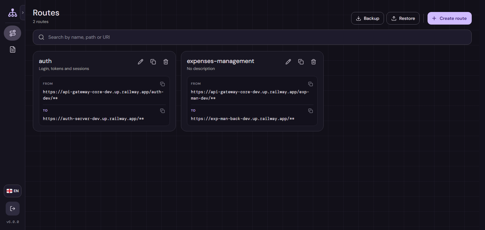
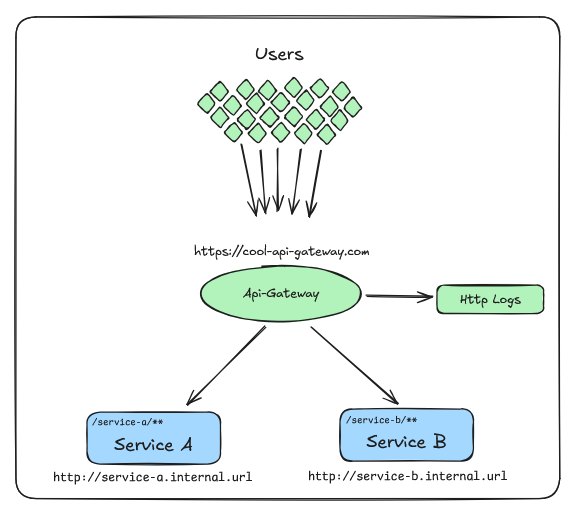
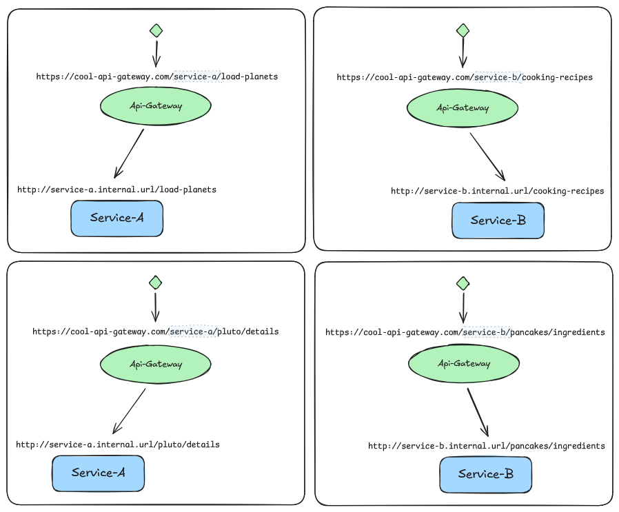
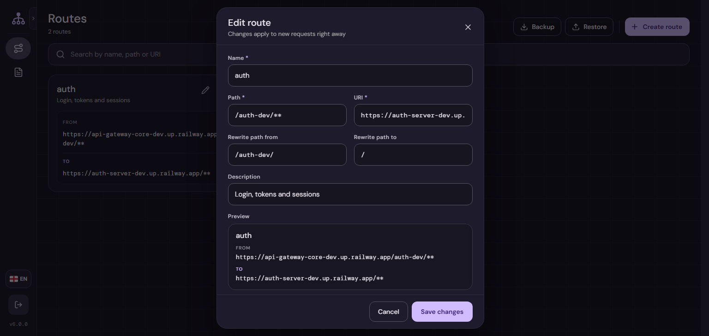
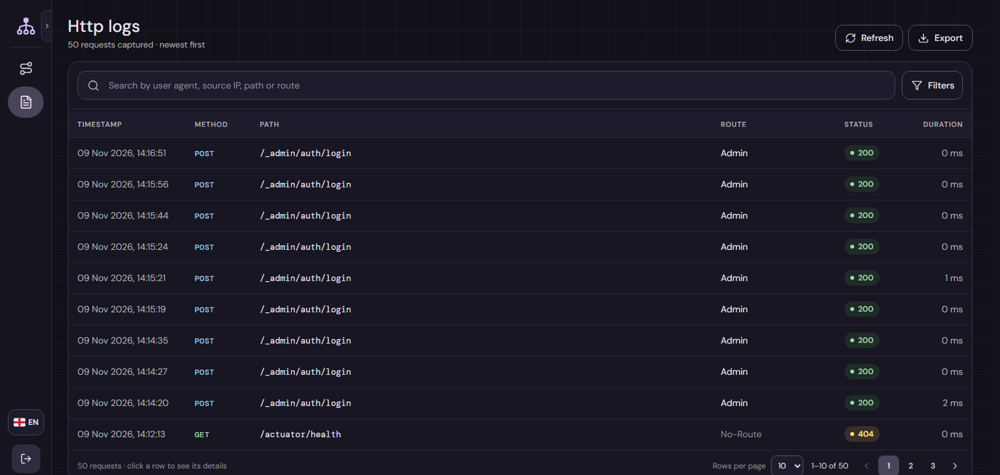
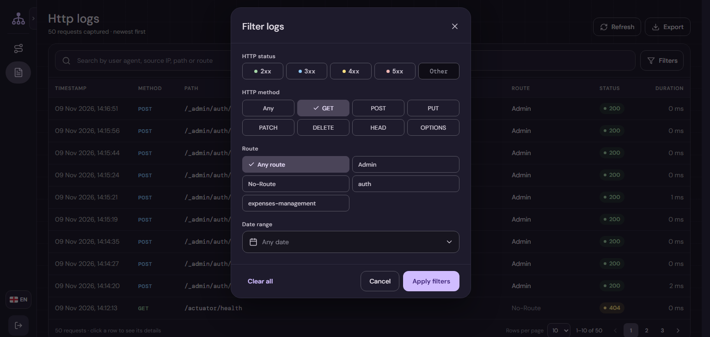
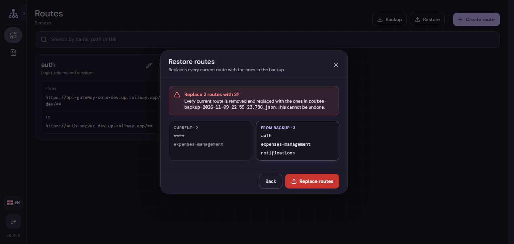

<p align="center">
  
</p>

<h1 align="center"><code>api-gateway</code></h1>

<p align="center"><i>One route to rule them all.</i></p>

A ready-to-deploy API gateway: one public URL in front of your services. Each request goes to the
service whose route matches its path, every request is logged, and a web console manages the routes
and searches the logs, all without redeploying anything.

- **`gateway/`**: the gateway, in Java 25 on Spring Boot 4 and Spring Cloud Gateway (WebFlux),
  built as a GraalVM native image. It routes the traffic, serves the admin API and keeps its
  routes and logs in PostgreSQL.
- **`console/`**: the web console, in Flutter Web, served by nginx in its own image.

> **Status: `6.0.0`.** A restructuring release, with breaking changes in the admin API: read
> [`CHANGELOG.md`](CHANGELOG.md) before upgrading from 5.x, and deploy the gateway and the console
> of the same version together.



## How it works



1. Users call a single public URL: `https://gateway.example.com`.
2. The gateway picks the route whose path matches and forwards the request to its service:
   `/service-a/**` → `http://service-a.internal`, `/service-b/**` → `http://service-b.internal`.
3. Each request and its answer are recorded in the HTTP logs.
4. The services stay private: only the gateway is exposed.

With a rewrite of the path, the prefix of the route is dropped on the way:

| Request to the gateway                              | Forwarded to                                    |
|-----------------------------------------------------|-------------------------------------------------|
| `https://gateway.example.com/service-a/planets`     | `http://service-a.internal/planets`             |
| `https://gateway.example.com/service-a/pluto/info`  | `http://service-a.internal/pluto/info`          |
| `https://gateway.example.com/service-b/recipes`     | `http://service-b.internal/recipes`             |



## What it does

|                 |                                                                                                                            |
|-----------------|----------------------------------------------------------------------------------------------------------------------------|
| **Routes**      | A path (`/users/**`), the service it goes to and an optional rewrite of the path; created, edited and deleted live         |
| **Protocols**   | HTTP and HTTPS, Server-Sent Events and WebSocket (see [Supported protocols](#supported-protocols))                        |
| **HTTP logs**   | Every request: when, method, path, route, status, duration, source IP and user agent; searchable, kept 14 days by default |
| **Backup**      | Every route to a JSON file, and back, all or nothing                                                                       |
| **Admin API**   | Everything the console does, for scripts and pipelines: token or Basic auth, with a lockout of brute force by IP           |
| **Console**     | Routes and logs, in English and Spanish; one image for every environment, configured at start                              |
| **Operations**  | A health check for load balancers, timeouts to the services (`502`/`504`), a native image of ~150 MB of memory             |

|                                                                 |                                                                          |
|-----------------------------------------------------------------|--------------------------------------------------------------------------|
|            |                         |
|    |  |

Every screen, its URL and what it calls: [`docs/console.md`](docs/console.md). The whole design, as
a PDF and images: [`docs/design/`](docs/design/README.md).

**What it doesn't do (yet):** routes by method, host or header, or with an explicit order (all
routes have the same priority: avoid overlapping paths); HTTP/2 and gRPC; raw TCP or UDP; more than
one admin user; several instances sharing their routes and tokens (run one). It serves HTTP: put a
proxy in front for TLS. See [`ROADMAP.md`](ROADMAP.md).

### Supported protocols

The gateway routes **HTTP traffic**: anything that starts as an HTTP request works, anything else
doesn't.

| Traffic                          | Works | Notes                                                                                                                                                                                                    |
|----------------------------------|:-----:|----------------------------------------------------------------------------------------------------------------------------------------------------------------------------------------------------------|
| HTTP / HTTPS                     |   ✅   | The main use case                                                                                                                                                                                         |
| SSE (Server-Sent Events)         |   ✅   | Streamed as they arrive. `GATEWAY_RESPONSE_TIMEOUT` only limits the wait until the response starts; a silent stream stays open, but proxies in front may close it: send a heartbeat (`:` every 15–30 s) |
| WebSocket (`ws` / `wss`)         |   ✅   | The route keeps an `http(s)://` URI: the gateway switches to `ws(s)://` when the client asks for the upgrade                                                                                             |
| HTTP/2 / gRPC                    |   ❌   | Not configured yet: gRPC needs HTTP/2 end to end, and the gateway speaks HTTP/1.1 on both sides                                                                                                          |
| Raw TCP / UDP (databases, MQTT…) |   ❌   | Not possible by design: the gateway picks the route from the method, path and headers, which raw TCP/UDP doesn't have. Use a layer 4 proxy (nginx `stream`, HAProxy, Traefik TCP)                     |

An SSE stream or a WebSocket is logged once, when it opens: its duration is the wait for the
service's answer, and its messages are not logged.

## Run it

### With Docker Compose

[`docker-compose.yml`](docker-compose.yml) builds and runs the three pieces: PostgreSQL, the gateway
and the console.

```bash
git clone https://github.com/Root-101/api-gateway.git
cd api-gateway
docker compose up -d --build
```

- Gateway: <http://localhost:8080> (admin API at `/_admin`).
- Console: <http://localhost>, log in with `admin` / `admin123**`.
- PostgreSQL: `localhost:5432`, its data in the `postgres_data` volume.

The first build compiles the native image and takes several minutes. Change the passwords before
exposing it: the gateway warns in its log when it runs with the default ones.

### On Railway

[](https://railway.app/template/IR4lVv?referralCode=6_5_ta)

The template deploys PostgreSQL, the gateway and the console (see [`docs/railway.md`](docs/railway.md)).
The whole stack runs in 200–250 MB of memory, about 1.50–2.00 USD a month.

### Locally

The gateway needs a **JDK 25** (Gradle finds it through its toolchain) and a PostgreSQL; it runs its
migrations on start.

```bash
# Gateway, on port 8080, against a local PostgreSQL
cd gateway
DB_HOST=localhost DB_NAME=api-gateway DB_USERNAME=postgres DB_PASSWORD=… ./gradlew bootRun

# Console, apart: it reads the gateway's URL from web/env.js
cd console
cp web/env.example.js web/env.js
fvm flutter pub get
fvm flutter run -d chrome
```

Tests run from `gateway/`: `./gradlew test` (unit, fast), `./gradlew integrationTest` (PostgreSQL
with Testcontainers, **Docker required**) and `./gradlew check jacocoTestReport` (both, with the
coverage gate). See [`CONTRIBUTING.md`](CONTRIBUTING.md).

## Configuration

Environment variables of the gateway, read on start:

| Variable                      | Default                  | What it is                                                                                                 |
|-------------------------------|--------------------------|------------------------------------------------------------------------------------------------------------|
| `ADMIN_USERNAME`              | `admin`                  | The user of the console and the admin API                                                                  |
| `ADMIN_PASSWORD`              | `admin123**`             | Its password; change it                                                                                    |
| `ADMIN_PATH`                  | `_admin`                 | Where the admin API lives (`/_admin/routes`); change it if a service needs that path                       |
| `ADMIN_TOKEN_MINUTES`         | `480`                    | How long a login token lasts                                                                               |
| `ADMIN_MAX_FAILED_ATTEMPTS`   | `10`                     | Wrong logins from one IP before it is locked (`0` disables it)                                             |
| `ADMIN_LOCKOUT_MINUTES`       | `15`                     | The window of the lockout                                                                                  |
| `DB_HOST`, `DB_PORT`          | `localhost`, `5432`      | Where PostgreSQL is                                                                                        |
| `DB_NAME`                     | `api-gateway`            | The database                                                                                               |
| `DB_USERNAME`, `DB_PASSWORD`  | `postgres`, `admin123`   | Its user and password; change the password                                                                 |
| `MAINTAIN_LOGS_FOR_DAYS`      | `14`                     | Days the HTTP logs are kept; older ones are deleted every night                                            |
| `MAX_LOGS_SEARCH_SIZE`        | `10000`                  | The biggest page a log search returns                                                                      |
| `CORS_ALLOWED_ORIGINS`        | `*`                      | Origins allowed to call the admin API, comma separated (`https://*.example.com`): the console's, at least  |
| `GATEWAY_CONNECT_TIMEOUT_MS`  | `10000`                  | Wait to connect to a service (`504` after it)                                                              |
| `GATEWAY_RESPONSE_TIMEOUT`    | `60s`                    | Wait for a service to start answering (`504` after it); empty for no limit, for slow exports or long polling |
| `PORT`                        | `8080`                   | Port of the gateway                                                                                        |
| `PROFILE`, `APPLICATION_NAME` | `default`, `Api-Gateway` | Spring profile and name; they can stay as they are                                                         |

The database is set in parts (host, port, name, user, password) instead of as a connection URL
because the gateway needs two URLs: an `r2dbc:` one for its reactive queries and a `jdbc:` one for
the Flyway migrations. It builds both from the same parts, so you set the database once and the two
can never point to different places.

The console has its own three (`GATEWAY_SERVICE_URL`, `ADMIN_PATH`, `SESSION_TIMEOUT_MINUTES`), read
when its container starts: see [`console/README.md`](console/README.md).

The security model, and how to deploy it safely (behind a proxy that sets `X-Forwarded-For`, one
instance), is in [`SECURITY.md`](SECURITY.md).

## The admin API

Under `/{ADMIN_PATH}`, JSON, with a token from the login (or Basic auth). Keys in `snake_case`,
dates in UTC, and every error a Problem Details (RFC 9457), with its `violations` in a `422`:

| Method   | Path                    | What it does                                                        |
|----------|-------------------------|---------------------------------------------------------------------|
| `GET`    | `/_admin/health`        | Health check, no auth: `{"status": "up"}`, or `503`                 |
| `POST`   | `/_admin/auth/login`    | Checks the credentials and gives an `access_token`                  |
| `GET`    | `/_admin/routes`        | Every route                                                         |
| `GET`    | `/_admin/routes/{id}`   | One route                                                           |
| `POST`   | `/_admin/routes`        | Creates a route: `201` with it                                      |
| `POST`   | `/_admin/routes/batch`  | Creates several, all or nothing: `201` with them                    |
| `PUT`    | `/_admin/routes`        | Replaces every route with the ones in the body (same name, same id) |
| `PUT`    | `/_admin/routes/{id}`   | Edits a route                                                       |
| `DELETE` | `/_admin/routes/{id}`   | Deletes a route: `204`                                              |
| `GET`    | `/_admin/http-logs`     | Searches the HTTP logs: page and filters in the query               |

Every call, with real requests and responses and its errors: [`docs/api.md`](docs/api.md). The
[Postman collection](docs/postman/Api-Gateway.postman_collection.json) has them all, with
assertions, and runs as a test suite (the CI runs it against the native image):

```bash
postman collection run docs/postman/Api-Gateway.postman_collection.json \
  -e "docs/postman/Api-Gateway - Local.postman_environment.json"
```

It creates and deletes its own routes, and makes two wrong logins on purpose (they count for the
lockout; a correct one resets it).

## Versions

Each major version has its tag; prefer the latest of each (`4.2.0` over `4.0.0`), and the latest
major for its fixes. What changed in each one: [`CHANGELOG.md`](CHANGELOG.md).

| Version | What it brought                                                                                                        |
|---------|------------------------------------------------------------------------------------------------------------------------|
| **2.x** | Routes from environment variables: changing one meant redeploying                                                      |
| **3.x** | The admin API: routes changed live                                                                                     |
| **4.x** | PostgreSQL keeps the routes across restarts; the native image (~500 MB → ~150 MB of memory) and the first console      |
| **5.x** | The HTTP logs                                                                                                          |
| **6.x** | A restructuring: Java 25 and Spring Boot 4, login tokens, lockout, timeouts, health check, a new console, tests and CI |

## Documentation

- [`docs/api.md`](docs/api.md): the admin API, with real requests and responses, how a request is
  routed and what gets logged.
- [`docs/console.md`](docs/console.md): a tour of the console, screen by screen, with the calls each
  one makes; and [`docs/design/`](docs/design/README.md), its design as a PDF and images.
- [`docs/brand.md`](docs/brand.md): the icon, its colors and type (files in
  [`docs/design/brand/`](docs/design/brand)).
- [`docs/railway.md`](docs/railway.md): the Railway template.
- [`console/README.md`](console/README.md): configuring and running the console.
- [`SECURITY.md`](SECURITY.md): the security model and how to deploy it safely.
- [`DECISIONS.md`](DECISIONS.md): the non-obvious design decisions and why.
- [`ROADMAP.md`](ROADMAP.md): what comes next.
- [`CONTRIBUTING.md`](CONTRIBUTING.md).

## License

[Apache License 2.0](LICENSE).
