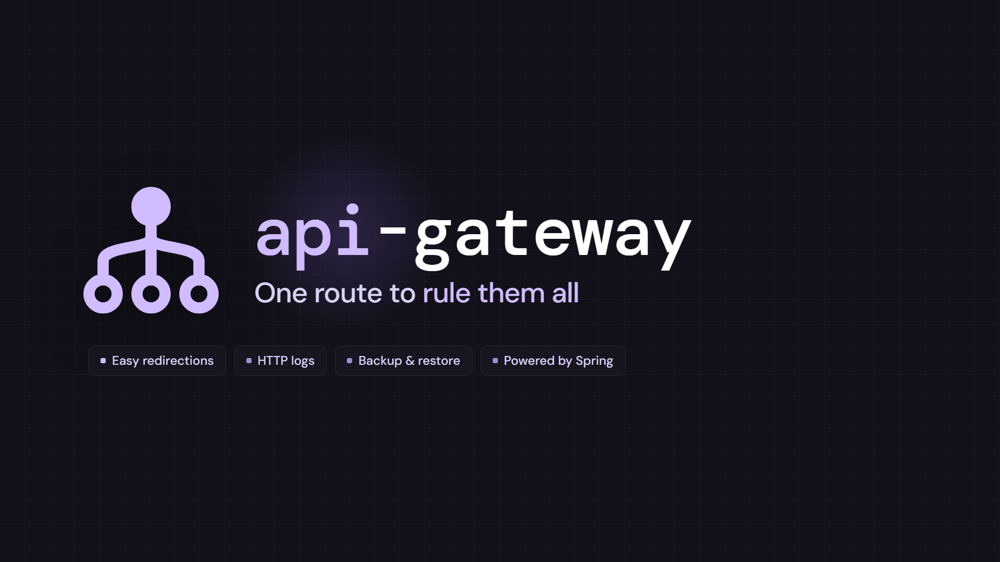
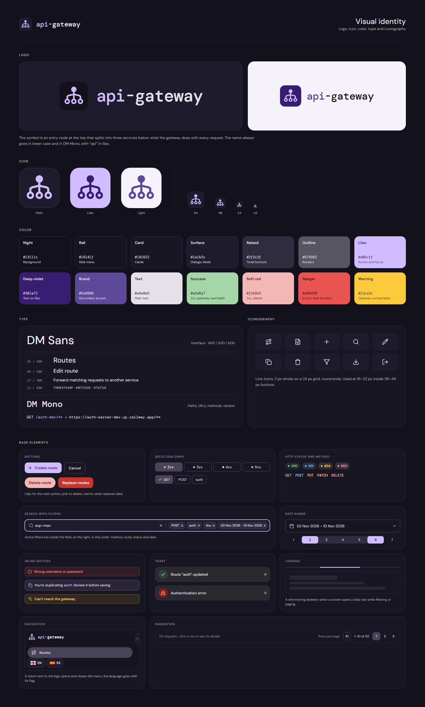

# The brand

The visual identity of api-gateway: the icon, its colors and type, and the image used to present
the project. Everything here comes from the Claude Design canvas "API Gateway Console" (its page
*Visual identity*) and is exported to [`design/brand/`](design/brand) (see
[`design/README.md`](design/README.md)).

The whole identity on one sheet: the logo on dark and light, the icon and its sizes, the palette,
the type, the icons and the base elements of the console (buttons, chips, the search with its
filters, notices, toasts, loading, navigation and pagination). The sections below detail each part.

## The icon

One node at the top that splits into three below: an entry point that hands each request to the
service it belongs to, which is what the gateway does. The name always goes in lower case and in
DM Mono, with *api* in lilac: <code><b>api</b>-gateway</code>.

  

### Construction

The glyph is drawn on a 24 × 23 grid (the `viewBox` of `icon.svg`), with line icons' rules:

| Part           | Measures                                                                           |
|----------------|------------------------------------------------------------------------------------|
| Top node       | A filled circle, radius 2.5, at (12, 3.5)                                          |
| Trunk          | A line from (12, 6) to (12, 16.5)                                                  |
| Branches       | Two curves from (12, 9) that open to the left and right ends, down to y = 16.5     |
| Bottom nodes   | Three hollow circles, radius 2.5, at (3.5, 19), (12, 19) and (20.5, 19)            |
| Stroke         | 2 units, round caps and joins                                                      |

The **app icon** puts the glyph on a rounded tile (512 × 512, radius 116, a 4 unit inner ring),
scaled ×13.333 from (96, 96). It comes in three versions:

| Version   | Tile      | Ring                    | Glyph     | Use it for                                         |
|-----------|-----------|-------------------------|-----------|----------------------------------------------------|
| **Dark**  | `#1e1b2c` | `#d0bcff` at 14 %       | `#d0bcff` | The main one: favicon, the console, dark backgrounds |
| **Lilac** | `#d0bcff` | `#381e72` at 12 %       | `#381e72` | Where it must stand out                            |
| **Light** | `#f5f2fb` | `#381e72` at 10 %       | `#5d4999` | Light backgrounds                                  |

  
  &nbsp;
  
  &nbsp;
  

At small sizes the stroke grows a little so the glyph keeps its weight: 2 at 64 px, 2.25 at 40 px,
2.5 at 24 px and 2.75 at 16 px.

## Colors

The palette of the console, dark only:

| Name        | Color     | Use                                  |
|-------------|-----------|--------------------------------------|
| Night       | `#13111c` | Background                           |
| Rail        | `#16141f` | Side menu                            |
| Card        | `#181622` | Cards                                |
| Surface     | `#1e1b2c` | Dialogs, fields                      |
| Raised      | `#2f2c3f` | Tonal buttons                        |
| Outline     | `#575562` | Borders                              |
| Lilac       | `#d0bcff` | Main action and focus                |
| Deep violet | `#381e72` | Text on lilac                        |
| Brand       | `#5d4999` | Secondary accent, the glow           |
| Text        | `#e6e0e9` | Main text                            |
| Success     | `#a5d6a7` | 2xx, gateway reachable               |
| Soft red    | `#f2b8b5` | 5xx, delete                          |
| Danger      | `#e95450` | Errors, their borders                |
| Warning     | `#fdca3c` | Gateway unreachable                  |

Buttons follow it: lilac for the main action, soft red to delete, red for what replaces data
(restoring routes). The backgrounds of the brand images add a grid of lilac lines at 5 %, every
48 px, and a glow of `#5d4999` behind the name.

## Type

| Family                                             | Use                                               | Weights        |
|----------------------------------------------------|---------------------------------------------------|----------------|
| [DM Sans](https://fonts.google.com/specimen/DM+Sans) | The interface: titles 26 / 500, dialogs 20 / 500, text 15 / 400, column heads 12 / 600 | 400, 500, 600 |
| [DM Mono](https://fonts.google.com/specimen/DM+Mono) | The name, paths, URLs, methods and the version   | 400, 500       |

Both are under the SIL Open Font License and ship with the console (`console/assets/fonts/`).

## Icons

Line icons, 2 px stroke on a 24 px grid with round ends, used at 16–22 px inside 36–44 px buttons.

## Files

| File                                                                                       | What it is                          |
|--------------------------------------------------------------------------------------------|-------------------------------------|
| [`icon.svg`](design/brand/icon.svg)                                                        | The glyph alone, in lilac           |
| [`app-icon-dark.svg`](design/brand/app-icon-dark.svg) · [`.png`](design/brand/images/app-icon-dark.png)    | The app icon, dark (512 × 512)  |
| [`app-icon-lilac.svg`](design/brand/app-icon-lilac.svg) · [`.png`](design/brand/images/app-icon-lilac.png) | The app icon, lilac             |
| [`app-icon-light.svg`](design/brand/app-icon-light.svg) · [`.png`](design/brand/images/app-icon-light.png) | The app icon, light             |
| [`images/identity.png`](design/brand/images/identity.png)                                  | The identity, 1920 × 1080: for presentations and the social preview |
| [`images/banner.png`](design/brand/images/banner.png)                                      | The identity cropped to its content, 1370 × 544, by hand: the README header |
| [`images/identity-sheet.png`](design/brand/images/identity-sheet.png)                      | The identity sheet, 1600 × 2660: logo, icon, palette, type, icons and base elements |

The PNGs are rendered from the canvas by `design/tool/export.py`; the SVGs are kept by hand with the
same values.
