# The console

A tour of the web console of the gateway: each screen, its URL and what it does. The images come
from the design of the console ([`design/`](design/README.md)), a faithful replica of what is
built; the console itself speaks English and Spanish (the flag in the rail).

The console is its own app (`console/`, Flutter Web served by nginx), apart from the gateway. It
reads where the gateway is at container start, from `GATEWAY_SERVICE_URL` (required) and
`ADMIN_PATH` (optional, `_admin` by default, like the gateway's) (see
[`console/README.md`](../console/README.md)), and talks to it only through the
[admin API](api.md), with the token of the login as `Authorization: Bearer …`. So the gateway must
allow the console's origin in `CORS_ALLOWED_ORIGINS`.

The console uses hash URLs: the screen goes after `#` (`https://console.example.com/#/logs`). Every
screen has its own URL, so it can be bookmarked, reloaded and reached with back and forward.

Each screen ends with **Behind it**: the calls it makes, explained with examples in
[`api.md`](api.md). The paths below use the default `ADMIN_PATH`, `_admin`.

## Starting

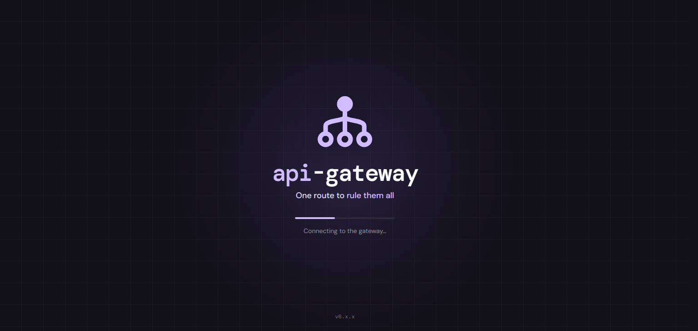

While the browser downloads the app, the logo, *One route to rule them all* and a bar, with the
version of the console at the foot.

## Log in

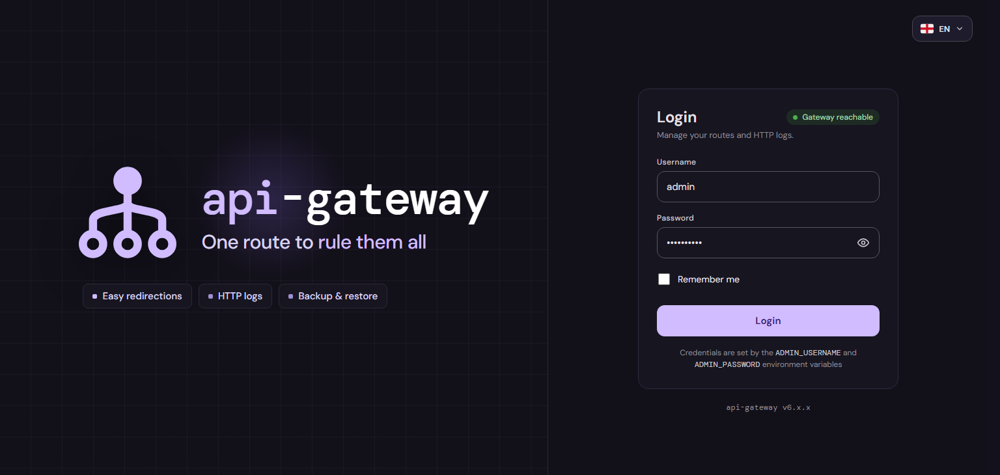

**URL:** `/#/login`

The brand on the left (the icon, the tagline and what the gateway does) and the form on the right:
the username and password of the admin, set on the gateway with `ADMIN_USERNAME` and
`ADMIN_PASSWORD` (the hint under the form names them). The badge at the top of the form says if the
gateway answers (*Gateway reachable*) or not, before you even try; any error, CORS included,
counts as unreachable. The language can be changed here too (top right).

**Remember me** keeps the token in the browser until it expires (`ADMIN_TOKEN_MINUTES`, 8 hours by
default), so closing the tab doesn't log out; a warning under it says to use it only on a trusted
device. Without it, the token lives only in the open tab. The password is never stored.

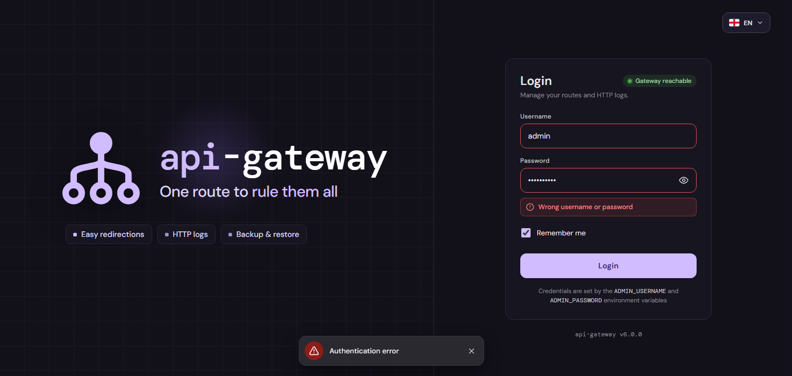

Wrong credentials mark both fields and say so in the form. After `ADMIN_MAX_FAILED_ATTEMPTS` wrong
tries from the same IP, the gateway stops taking its logins for `ADMIN_LOCKOUT_MINUTES` (a `429`,
whose message says how long to wait). In a narrow
window the brand goes above the form.

Logged out, any URL brings you here; logged in, this one takes you to the [Gateway map](#gateway-map), the start screen.

**Behind it:** [`GET /_admin/health`](api.md#health) for the badge, and
[`POST /_admin/auth/login`](api.md#log-in) with `{"username", "password"}`, which answers the token
(`access_token`) every other call sends. **Logout**, at the foot of the rail, only forgets the token.

## Navigation

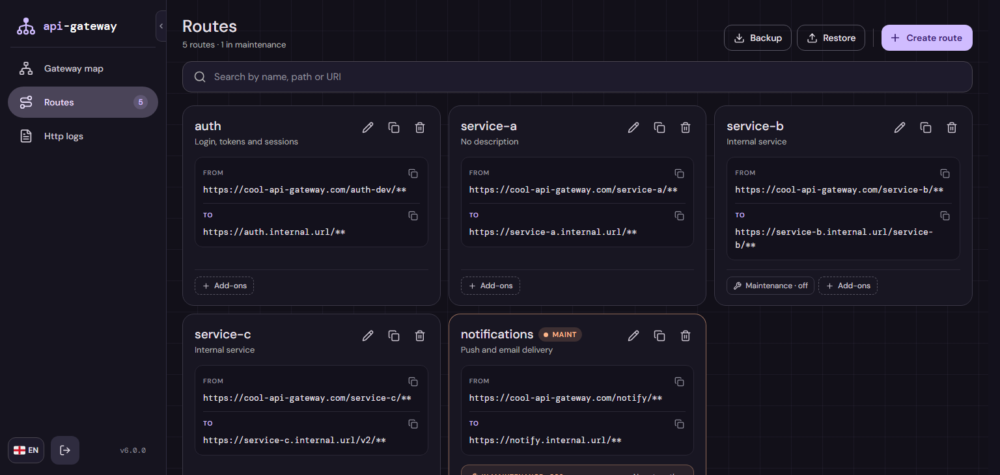

The rail on the left: **Gateway map** (see [Gateway map](#gateway-map)), **Routes** and **Http
logs**; at its foot the **language** (English or
Spanish; the browser's at first, the chosen one after that), **Logout** and the version of the
console. Every request carries it as `Accept-Language`, so the messages of the gateway (a field
it rejects, a route that doesn't exist) come in that language too
([Errors](api.md#errors)). The notch next to the logo expands it to show the names, and folds it again.

If `SESSION_TIMEOUT_MINUTES` is set on the console, it logs out after that many minutes without
mouse or keyboard activity.

## Routes

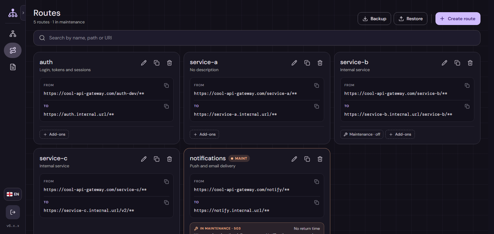

**URL:** `/#/routes`

Every route of the gateway as a card: its name and description, **FROM** (the public URL it
answers, the gateway's URL plus its path) and **TO** (where it forwards, with the rewrite of the
path applied), each with a button to copy it. Each card has **Edit**, **Duplicate** and
**Delete**, and at its foot a badge per add-on (**Health · every 30 s**, **Maintenance · on/off**,
**Rate limit · 60/min**)
and **+ Add-ons**; both open the panel of the route on the right (see [Add-ons](#add-ons)). Next to
the name, **MAINT** when its maintenance is on, or **PAUSED** for every route while the whole
gateway is in maintenance; otherwise **LIVE** or **DOWN** from its [health check](#health-check).
The search at the top filters by name, path or URI, in the browser.

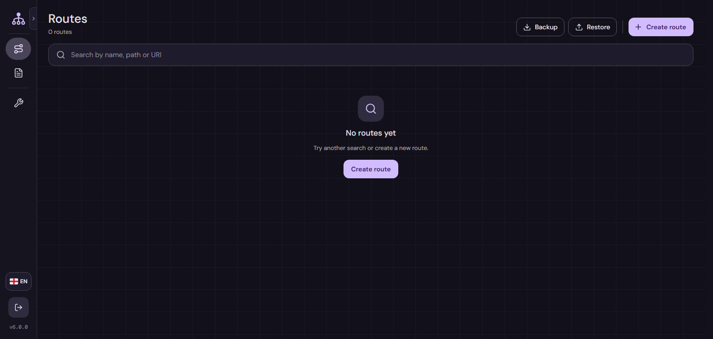

**Behind it:** [`GET /_admin/routes`](api.md#list-routes).

### Create, edit and duplicate

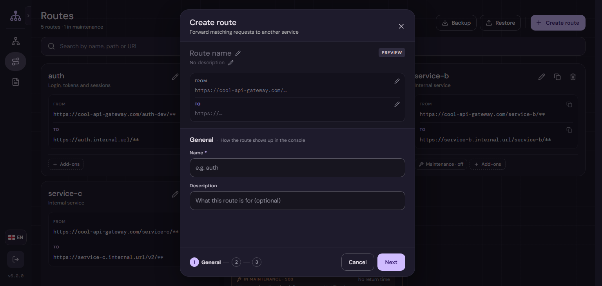

**Create route** opens the form, in three steps:

| Step             | Fields                                   | What they are                                                                       |
|------------------|------------------------------------------|-------------------------------------------------------------------------------------|
| **General**      | **Name**, **Description**                | Name: unique, the one the logs show for this route. Description: optional           |
| **Forwarding**   | **Path**, **URI**                        | What a request must match (`/users/**`), and the service it forwards to             |
| **Path rewrite** | **Rewrite path from** / **to**           | Optional: the start of the path to replace, and what replaces it (`/users/` → `/`)  |

Above the steps, the **preview** shows the route as its card in Routes will: name, description,
FROM and TO (and the rewrite, if there is one), updated while you type; what's still empty shows
its placeholder, dimmed. The pencil next to each value goes to its step and selects its field.

**Next** checks only the fields of its step and stays there if one is wrong, marked under the
field; the error goes away when you type in it. The last step saves (**Create route** or **Save
changes**) after checking everything, and goes to the first step with an error. Enter is Next,
Esc or a click outside closes without saving. The rules are the gateway's own: each step is checked
with [`POST /_admin/routes/validate`](api.md#validate-a-route), so the console never keeps a copy;
only a name already used is checked against the list. What the gateway rejects when saving is
shown under its field too. The messages are the gateway's, in the language of the console.

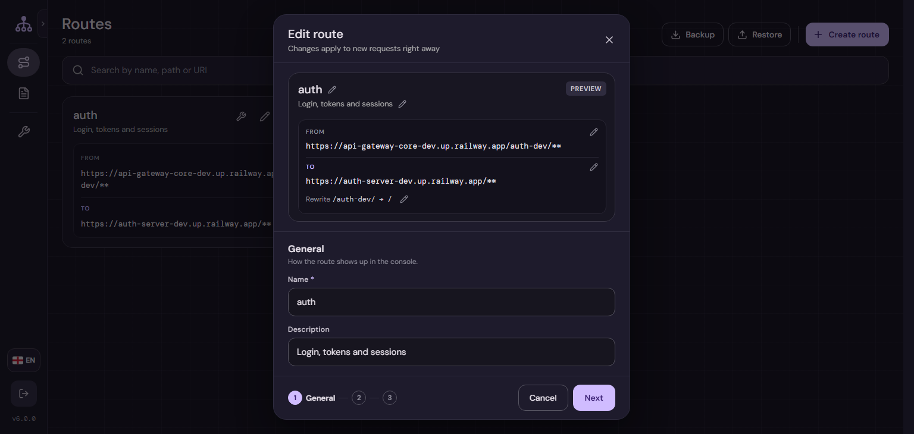

**Edit** opens the same form with the route; it has its own URL, `/#/routes/{id}/edit`, so a link
opens it (a route that doesn't exist says so). Changes apply to new requests right away.

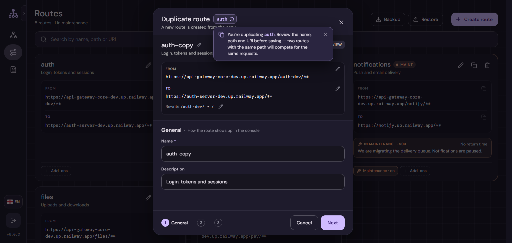

**Duplicate** opens the form with a copy (`auth-copy`, or the next free name). A chip with the name
of the original route sits next to the title; its ⓘ opens the warning: review the name, path and
URI, because two routes with the same path compete for the same requests (the first one created
wins).

**Behind it:** [`POST /_admin/routes/validate`](api.md#validate-a-route) on each Next,
[`POST /_admin/routes`](api.md#create-a-route) to create or duplicate,
[`GET /_admin/routes/{id}`](api.md#get-a-route) to open one by its URL, and
[`PUT /_admin/routes/{id}`](api.md#edit-a-route) to save the changes.

### Delete

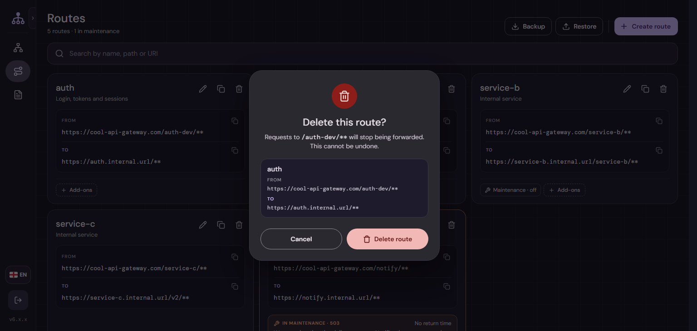

Asks first, with the route it deletes: requests to its path stop being forwarded (they get a `404`).

**Behind it:** [`DELETE /_admin/routes/{id}`](api.md#delete-a-route).

### Backup and restore

**Backup** downloads every route as a JSON file, `routes-backup-<date>.json`: a list with the same
fields as the form, and the add-ons of each route (`addons`, as the gateway sends them, without what
the gateway writes itself). The add-ons of the whole gateway are not in it.

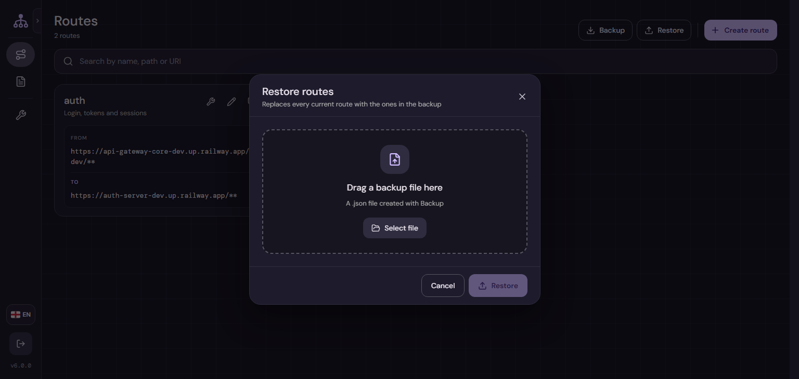

**Restore** takes one of those files: drop it on the dialog or **Select file**. A file that isn't a
list of routes, or that repeats a name (case-sensitive, like the API), says why and goes no further.

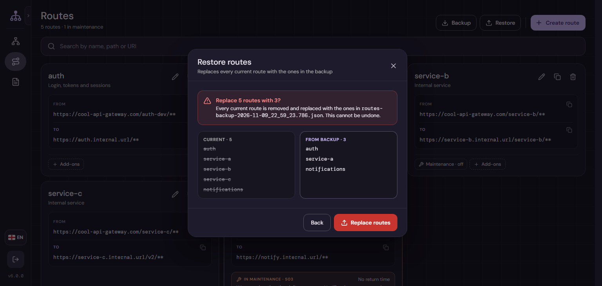

Then it asks to confirm, with the routes there are now and the ones in the file side by side:
**every current route is replaced** by the ones in the file, all or nothing. Routes are matched by
name (case-sensitive): one that already exists keeps its id, its logs and its add-ons, unless the
file says otherwise for an add-on (`null` removes it); one that isn't in the file is removed with
its add-ons; a new name is a new route.

**Behind it:** [`GET /_admin/routes`](api.md#list-routes) for the backup and
[`PUT /_admin/routes`](api.md#replace-every-route) to restore.

## Gateway map

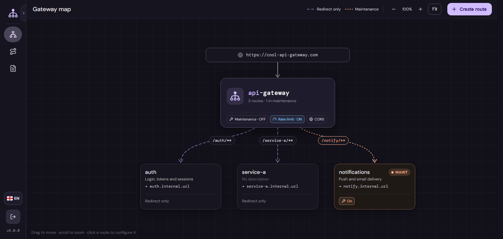

**URL:** `/#/map` · the start screen

The gateway as a diagram: its public URL on top, the gateway below it and a branch to each route,
with the path of the route on it. Each route card shows its name, description, the host it
forwards to and its add-ons (**Redirect only** when it has none). A branch is dashed lilac and
moving while the route forwards, dotted orange while it answers `503`, dotted red while its health
check says **DOWN** (it still forwards). Drag to move, the wheel to
zoom (40 % to 200 %), or the **−**, **+** and **Fit** buttons. **Create route** opens the usual
form.

A click on a route opens its panel on the right and dims the others; a click on the gateway opens
the gateway's; a click on the background closes it (see [Add-ons](#add-ons)). **Open in Routes**
goes to Routes with the search set to that route.

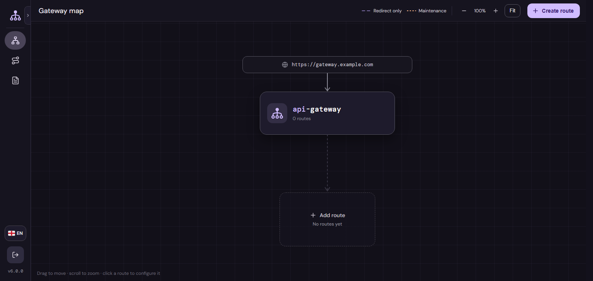

Without routes the map shows an **Add route** card that opens the form.

## Add-ons

Every route forwards its requests; everything else is an add-on, added, edited, turned on or off
and removed on its own. This version has three: **health check** (routes only), **maintenance**
and **rate limit** (both also for the whole gateway, from its panel in the map).
The panel of a route (from the map, or from the badges and **+ Add-ons** of its card in Routes)
shows its redirect, its add-ons and, under **Add to this route**, the ones it doesn't have yet (the
types the gateway lists for it).

### Health check

The gateway calls a path of the route's service on its own, every so often, and keeps the last
result: **LIVE** when it answered a 2xx, **DOWN** otherwise. It never changes the routing: a route
that is down still gets its requests.

| In the block                          | What it does                                                                     |
|---------------------------------------|----------------------------------------------------------------------------------|
| **Add to this route → Health check**  | Adds it, on, calling `/health` every 30 s                                        |
| **Run now** (play)                    | Calls it now and shows the result (up to 5 s), also while it's off               |
| **Edit** (pencil)                     | **Endpoint** (added to the route's URI), **Check every** (10 s to 1 h) and **Check on a schedule** (off: no calls, **Every** says `Off · every 30 s`) |
| **Remove** (trash)                    | Asks in the block itself, then removes it with its last result                   |

The block shows the endpoint, the interval and the **Last check**, ending in the state while it's on
(`12 s ago · 200 in 18 ms · LIVE`, `no answer · DOWN` when the service couldn't be reached or didn't
answer in 5 s). The (i) beside its name, as beside every add-on's, explains it in a popup. The gateway doesn't push the
results: the console rereads the routes every 10 seconds while one of them has it on.

**Behind it:** the [health check endpoints](api.md#health-check) of a route
(`/_admin/routes/{id}/addons/health-check`: `PUT`, `DELETE`, `POST …/run`).

### Rate limit

Past a number of requests per second, minute or hour from the same client IP, a `429 Too Many
Requests` with `Retry-After`, without reaching the service. A route's counts that route only; the
gateway's counts each IP on every route together; with both, both apply. Maintenance (`503`) is
checked first, and the admin API is never limited.

| In the block                        | What it does                                                                       |
|-------------------------------------|------------------------------------------------------------------------------------|
| **Add to this route → Rate limit**  | Adds it, off, at 60 per minute with a burst of 10                                  |
| **Limit requests** (switch)         | Turns it on or off, keeping the rest                                               |
| **Edit** (pencil)                   | **Requests**, **Burst** (the most at once; empty: the same as the limit) and the period (second, minute, hour) |
| **Remove** (trash)                  | Asks in the block itself, then removes it: it shows under **Add to …** again      |

Any change (save, on, off, remove) starts every count from zero.

**Behind it:** the [rate limit endpoints](api.md#rate-limit) of a route
(`/_admin/routes/{id}/addons/rate-limit`: `PUT`, `DELETE`, `POST …/enable`, `POST …/disable`) and
of the gateway (`/_admin/addons/rate-limit`: `PUT`, `DELETE`, `POST …/enable`, `POST …/disable`).

### Maintenance

A route in maintenance answers every request with a `503` without reaching its service; the whole
gateway can be put in maintenance too, from its own panel in the map, and then every route does.
The console, `/health` and the admin API keep working. It never turns off by itself.

| In the block        | What it does                                                                                       |
|---------------------|----------------------------------------------------------------------------------------------------|
| **Add to this route → Maintenance mode** | Adds it, off, with the gateway's default message                              |
| The slide           | Right turns it on, left turns it off (or the arrow keys), no confirmation                           |
| **Edit** (pencil)   | **503 message**, optional, up to 500 characters (empty: the default one, marked *default*), and **Back around**, optional: callers get it as `Retry-After` while it's ahead |
| **Remove** (trash)  | Asks in the block itself, then removes it with its message and time: it shows under **Add to …** again |

Under its state, how long it has been on, or how long the last window lasted, in large units (`2h 30 min`,
`1d 3h`); it moves on by itself every 10 seconds, like the gateway node of the map and the banner's countdown.

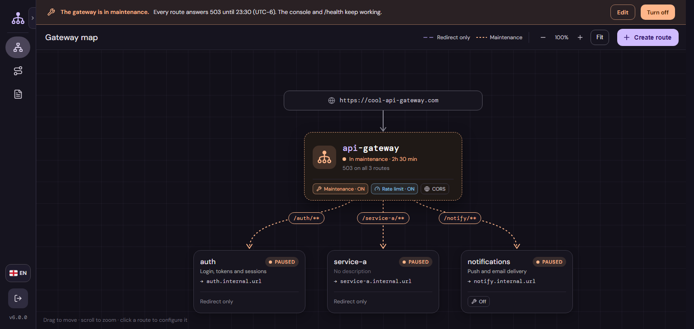

While the whole gateway is in maintenance it wins: every route answers its message and shows
**PAUSED**, and their slides are locked (**Controlled by the gateway**) until it's off; they keep
their own settings. A banner on every screen says so, with when it is back, **Edit** (the map with
the gateway's panel open) and **Turn off** (which keeps the message and the time).

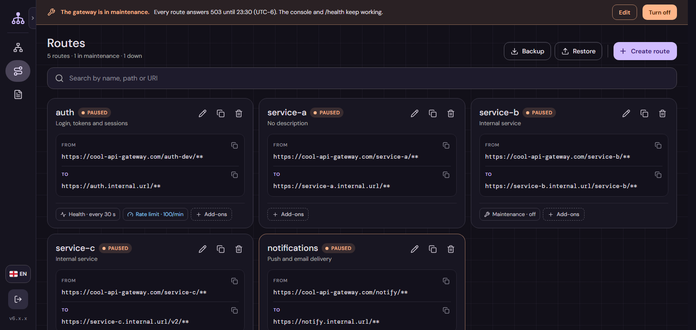

**Behind it:** [`GET /_admin/routes`](api.md#list-routes) and [`GET /_admin/addons`](api.md#add-ons)
to draw it, and the [maintenance endpoints](api.md#maintenance) of a route
(`/_admin/routes/{id}/addons/maintenance`: `PUT`, `DELETE`, `POST …/enable`, `POST …/disable`) and
of the gateway (`/_admin/addons/maintenance`: `PUT`, `DELETE`, `POST …/enable`, `POST …/disable`).

## Http logs

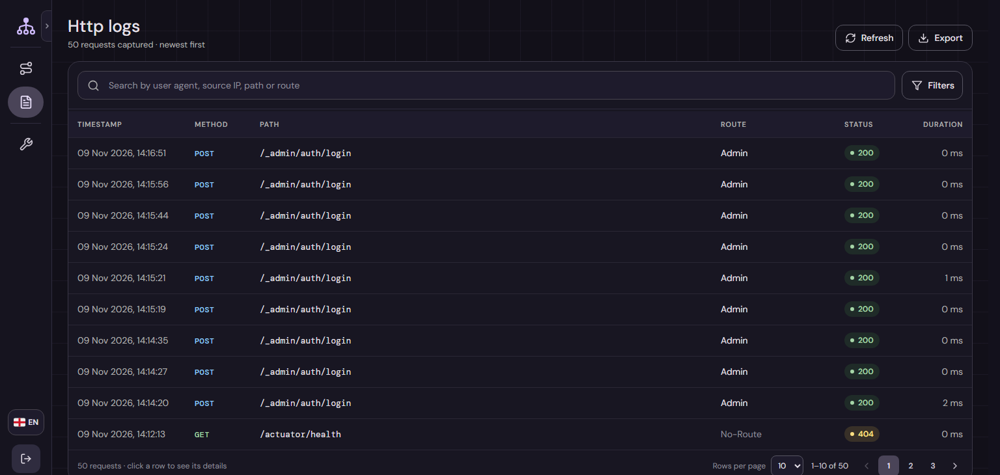

**URL:** `/#/logs`

Every request that went through the gateway, newest first: when, the method, the path, the route
that took it (*No-Route* when none matched), the status and how long it took. Logs are kept
`MAINTAIN_LOGS_FOR_DAYS` (14 by default); what isn't logged is in
[`api.md`](api.md#what-gets-logged).

The search filters by user agent, source IP, path or route, on the gateway, as you type. Pages of 10, 25 or 50
rows. **Refresh** loads the newest and says how many came in. **Export** downloads every log
of the current search and filters, page by page, as `logs-export-<date>.json`, with the filters it
used.

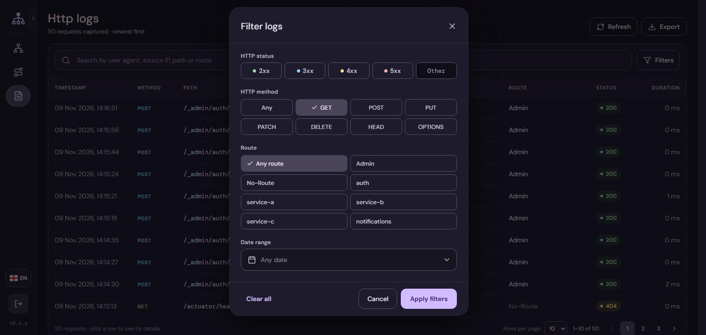

**Filters** narrows by **HTTP status** (2xx, 3xx, 4xx, 5xx, or an exact code), **HTTP method**,
**route** (or *Admin*, or *No-Route*) and a **date range**, picked on a calendar with shortcuts (today, last 7
or 30 days, this month). The active ones show as chips inside the search field, each with its
remove button.

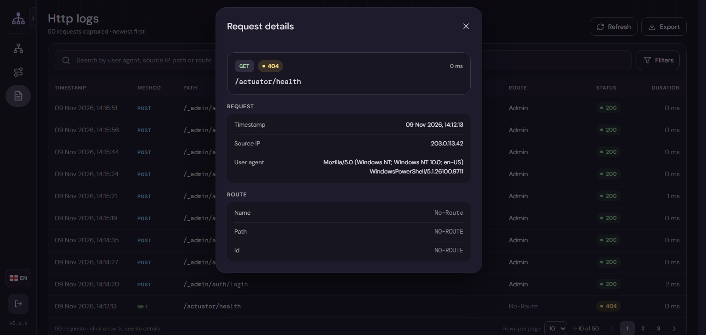

A click on a row opens its details: the method, status, path and duration, then the request
(timestamp, source IP, user agent) and the route (name, path, id), with a link to open the route.

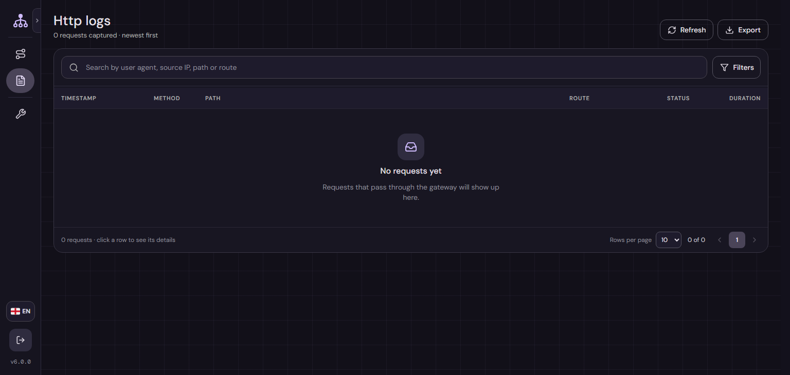

**Behind it:** [`GET /_admin/http-logs`](api.md#search-the-logs) for the table, every filter,
the refresh and each page of the export.

## States

### Loading

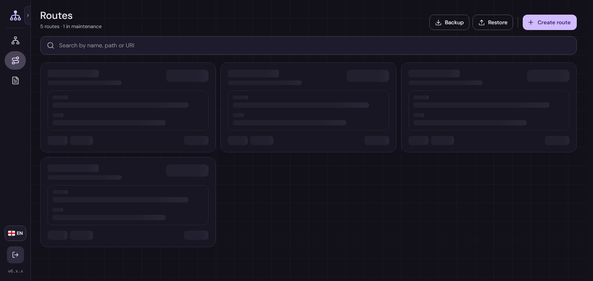

Entering a screen shows a skeleton of itself until its data arrives; filtering or changing page
dims the table under a bar.

### The gateway can't be reached

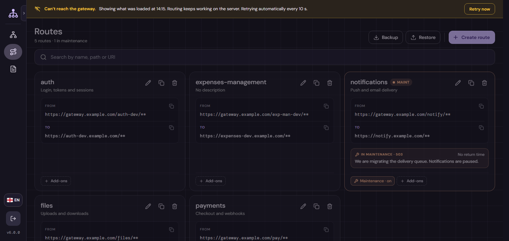

When a call can't reach the gateway, a banner says so and keeps what was already loaded on screen:
routing keeps working on the server. It retries every 10 seconds, or now with **Retry now**, and
says when the connection is back.

**Behind it:** [`GET /_admin/health`](api.md#health).

### Session expired

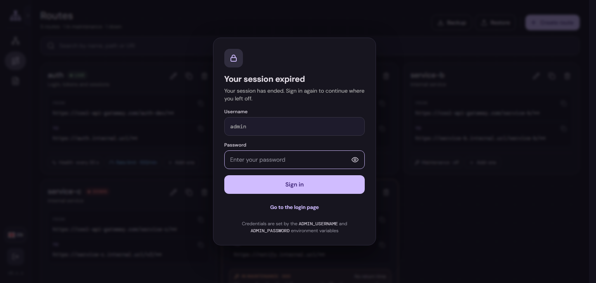

When the token expires (or the gateway restarted, which forgets every token), the screen you were
on stays under a dialog that logs in again with the password, or goes to the login page; it can't
be closed any other way. Like the login, it shows the password with the eye and recalls the
environment variables of the credentials.

**Behind it:** any admin call answered `401` or `403`, then [`POST /_admin/auth/login`](api.md#log-in).

### Not found

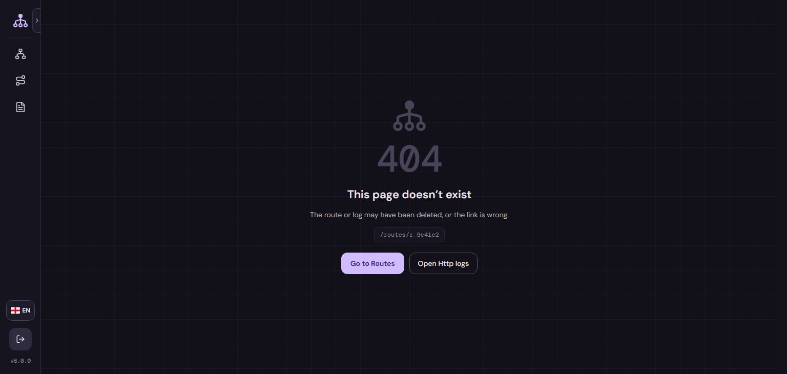

**URL:** `/#/not-found?path=…`

A URL of the console that doesn't exist, with the one asked for and buttons to the Gateway map and Http
logs.
