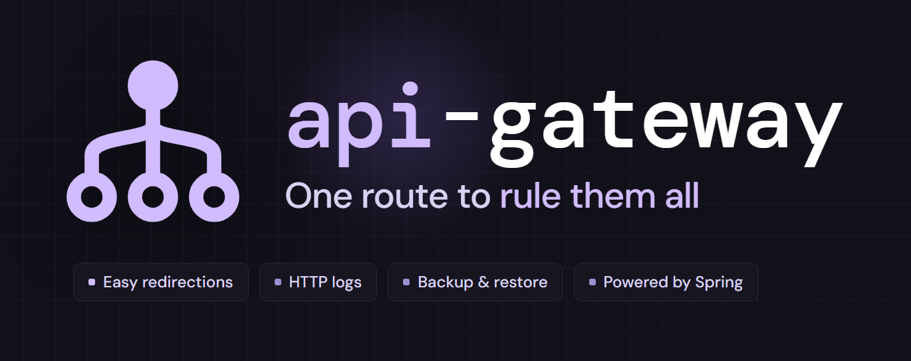

# Api-Gateway

A lightweight and cost-efficient ready-to-deploy **API Gateway**: one public URL in front of your services.
Each request goes to the service whose route matches its path, every request is logged, and a web console manages the
routes and searches the logs, all without redeploying anything.

👉 Full docs, examples, screenshots and all you need to know, are available in the
official [GitHub Repo](https://github.com/Root-101/api-gateway).

## 📌 Version `6.0.0`

Ready images on GHCR, PostgreSQL 18 by default, safer defaults and a standardized admin API (breaking: deploy the
gateway and the console of the same version together). Every detail in the
[CHANGELOG](https://github.com/Root-101/api-gateway/blob/master/CHANGELOG.md).

### Coming from 5.x?

Your routes and logs are kept: the gateway updates the database by itself when it starts. Pick one of these:

**Option 1: switch your services to the images (recommended).**

In each service: **Settings** → **Source** → disconnect the GitHub repo and connect its image:

* Gateway: `ghcr.io/root-101/api-gateway:latest`
* Console: `ghcr.io/root-101/api-gateway-console:latest`

The variables stay as they are, and so does your database (its PostgreSQL version doesn't change).

**Option 2: deploy the template from scratch, in the same project.**

1. Deploy this template into the project of your old services.
2. Delete the PostgreSQL database that comes with the new template.
3. Copy the variables of the old services to the new ones: the new gateway then points to the old database, with
   all its routes and logs. In the new console, point `GATEWAY_SERVICE_URL` and `ADMIN_PATH` to the **new** gateway
   service.
4. Move the domains of the old services (public and custom) to the new ones, and delete the old services.

With this option the database also stays the old one: to move to PostgreSQL 18 you have to migrate the data
yourself (for example, `pg_dump` and `pg_restore`), or keep the new database, export the routes from the old console
and import them in the new one, losing the logs.

---

# Deploy and Host Api-Gateway on Railway

An **API Gateway** acts as a single entry point for all client requests, routing them to the appropriate internal
services. Instead of clients communicating directly with multiple microservices, they only interact with the gateway,
which handles:

* 🔀 **Request routing** → A path (`/users/**`), the service it goes to and an optional rewrite of the path; created,
  edited and deleted live.
* 🌐 **Protocols** → HTTP and HTTPS, Server-Sent Events and WebSocket.
* 📜 **Centralized logging** → Every request: when, method, path, route, status, duration, source IP and user agent;
  searchable, kept 14 days by default.
* 🔒 **Service abstraction** → Clients don't need to know the internal URLs of services. Services may stay private.
* 💾 **Backup** → Every route to a JSON file, and back, all or nothing.
* 🛠️ **Admin API** → Everything the console does, for scripts and pipelines: token or Basic auth, with a lockout of
  brute force by IP.
* 🖥️ **Admin Console** → Manage routes and search the HTTP logs, in English and Spanish.

## About Hosting Api-Gateway

Hosting the Api-Gateway on Railway provisions a complete setup out-of-the-box. The deployment includes:

1. A **PostgreSQL database** to persist routes and logs.
2. The **gateway**, which routes the traffic, serves the admin API and logs every request. Java 25 on Spring Boot 4
   and Spring Cloud Gateway, built as a GraalVM native image.
3. The **web console**, in Flutter Web served by nginx, to manage routes and logs visually.

This setup isolates your internal microservices from the public internet while providing a single unified API endpoint.

> 📌 The whole stack runs in around **200–250 MB RAM** (the gateway alone, ~150 MB), about 1.50–2.00 USD a month.

---

## Common Use Cases

* **Unified API Endpoint** → Expose a single public URL while routing internally to multiple microservices.
* **Improved Security** → Keep microservices private and expose only the gateway to the internet.
* **Logging & Monitoring** → Store and search traffic logs for auditing and debugging.
* **Live changes** → Add, edit or move routes without redeploying anything.

> 📌 **Next on the roadmap** → Maintenance mode, rate limiting per route, authentication towards the services
> (JWT / API key), circuit breaker and retries, request tracing, and metrics per route.

---

## Dependencies for Api-Gateway

### Core Dependencies:

* **PostgreSQL** → Primary database for storing routes and logs.

### Deployment Dependencies

* Railway PostgreSQL Template: [https://railway.com/template/postgres](https://railway.com/template/postgres)
* Api-Gateway Gateway: [api-gateway/gateway](https://github.com/Root-101/api-gateway/tree/master/gateway)
* Api-Gateway Web Console: [api-gateway/console](https://github.com/Root-101/api-gateway/tree/master/console)
* Ready images: `ghcr.io/root-101/api-gateway:<version>` and `ghcr.io/root-101/api-gateway-console:<version>`

---

### Implementation Details (Optional)

* The admin credentials are generated at random when the template is deployed: find them in the **Variables** tab of
  the gateway service (`ADMIN_USERNAME` and `ADMIN_PASSWORD`).
* The **gateway** and the **DB** are connected through **private networking**, so the project must have private
  networking enabled in order for it to work correctly.
* The **web console** calls the gateway through its public domain (`RAILWAY_PUBLIC_DOMAIN`), on the admin path set in
  `ADMIN_PATH`. Both services must have the same `ADMIN_PATH`.
* Built from the repository, the services need their root directory: `/gateway` for the gateway and `/console` for
  the web console.
* Health check for load balancers: `GET /{ADMIN_PATH}/health` (no auth).
* Requests to a service that is down get a `502`, and to one that is too slow, a `504` (after 60 s by default: raise
  `GATEWAY_RESPONSE_TIMEOUT` for services with slower endpoints).
* Run a single instance of the gateway: the login tokens live in memory, and a restart logs everyone out.

#### Gateway variables

| Variable | Template value | Description |
| - | - | - |
| `PORT` | `8080` | Port the service listens on |
| `DB_HOST` | `${{Postgres.PGHOST}}` | Host of the database |
| `DB_PORT` | `${{Postgres.PGPORT}}` | Port of the database |
| `DB_NAME` | `${{Postgres.PGDATABASE}}` | Name of the database |
| `DB_USERNAME` | `${{Postgres.PGUSER}}` | User of the database |
| `DB_PASSWORD` | `${{Postgres.PGPASSWORD}}` | Password of the database user |
| `ADMIN_USERNAME` | random, 10 characters | User of the admin API and the web console |
| `ADMIN_PASSWORD` | random, 20 characters | Password of the admin user |
| `ADMIN_PATH` | `_admin` | Base path of the admin API. Same value on the web console |
| `MAINTAIN_LOGS_FOR_DAYS` | `14` | Days the HTTP logs are kept |

Optional, with their default when not set:

| Variable | Default | Description |
| - | - | - |
| `GATEWAY_RESPONSE_TIMEOUT` | `60s` | Longest wait for a service to answer, then `504`. Empty = no limit |
| `GATEWAY_CONNECT_TIMEOUT_MS` | `10000` | Longest wait to connect to a service, in milliseconds, then `504` |
| `CORS_ALLOWED_ORIGINS` | `*` | Comma separated origins allowed by CORS, for the admin API and every route |
| `ADMIN_MAX_FAILED_ATTEMPTS` | `10` | Failed logins from one IP before it's locked out. `0` disables the lockout |
| `ADMIN_LOCKOUT_MINUTES` | `15` | Minutes a locked out IP waits |
| `ADMIN_TOKEN_MINUTES` | `480` | Minutes a login token lasts |
| `MAX_LOGS_SEARCH_SIZE` | `10000` | Most logs a search returns in one page |

#### Web console variables

Read when the container starts, so changing them only needs a restart, not a new build.

| Variable | Template value | Description |
| - | - | - |
| `GATEWAY_SERVICE_URL` | `https://${{api-gateway.RAILWAY_PUBLIC_DOMAIN}}` | Public URL of the gateway, without the admin path |
| `ADMIN_PATH` | `${{api-gateway.ADMIN_PATH}}` | Admin path of the gateway |
| `SESSION_TIMEOUT_MINUTES` | `0` (optional) | Minutes without activity before logging out. `0` = never |

`api-gateway` is the name of the gateway service in the project: use the name it has in yours.

---

### Why Deploy Api-Gateway on Railway?

Railway is a singular platform to deploy your infrastructure stack. Railway will host your infrastructure, so you don't
have to deal with configuration, while allowing you to vertically scale it.

By deploying Api-Gateway on Railway via this template, you are one step closer to supporting a complete full-stack
application with minimal burden: you get a powerful, lightweight, fully configured, ready to use,
super magic with sprinkles, and reliable api gateway, that would take your multi services architecture to the next
level.

---

This is after all a project designed for deploy in railway as a template... so:

